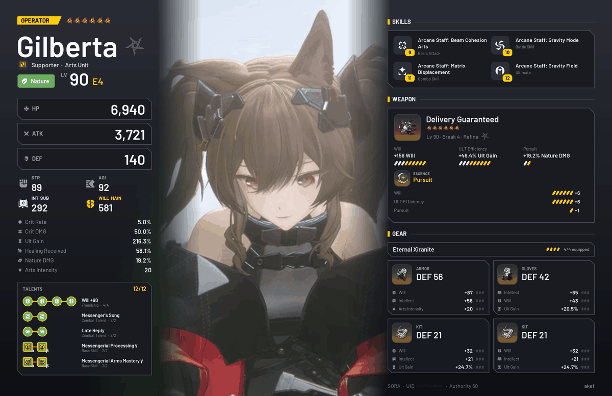
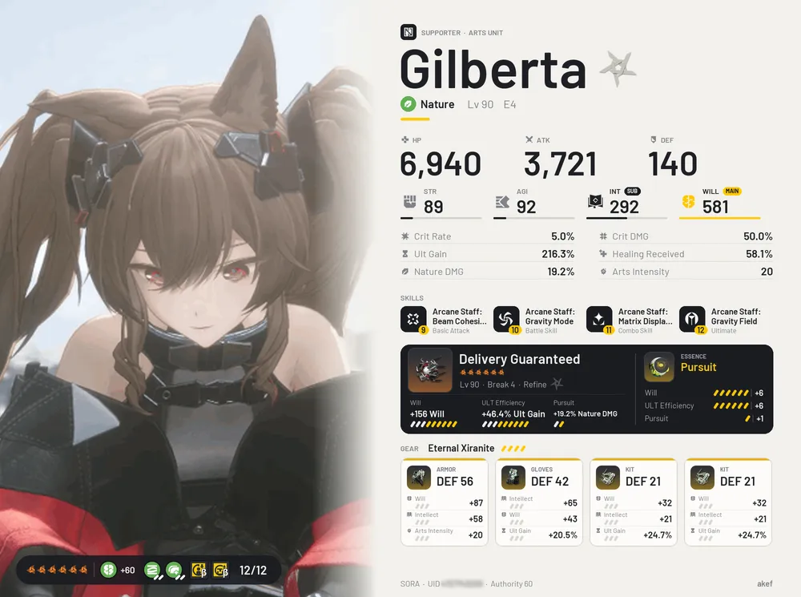

# Animated operator card

Give the operator card a gif or animated webp and the art moves, everything else stays put. Works on both
templates.



## Quick way

```py
file = await cards.render_animated(build, Path("art.gif"))                 # BytesIO named card.webp
file = await cards.render_animated(build, attachment_bytes, template=2, format="GIF")
```

| Option | |
| --- | --- |
| `template` | `1` light (default), `2` dark |
| `format` | `"WEBP"` (default) or `"GIF"`. GIF is a lot bigger and only has 256 colours |
| `quality` | webp quality, 80 by default |
| `fit` | `"contain"` (default) whole animation on a blurred backdrop, `"cover"` fill and crop, `"auto"` covers if that cuts under 20%, else contains |
| `focus` | `(x, y)` from 0 to 1, which part `cover` keeps. `(0.5, 0.5)` is the middle |
| `width` | output width in px, 1000 by default, never upscales |
| `frame_step` | `2` by default, drops every 2nd frame. `1` keeps them all, bigger and slower |
| `hidden`, `allow_local`, `allow_remote` | same as the still card |

Long animations skip more frames so there's never more than 120, the loop stays the same length either way.
Very big ones (too many frames times pixels) get a `CardError`. It takes a few seconds and isn't cached.

## Check the file first

```py
info = await cards.animation_info(Path("art.gif"))
# AnimationInfo(width=370, height=498, frames=44, duration=1.6, fit='cover')
```

`fit` is what `fit="auto"` would pick for it.

## Editing before export

`animated_card()` takes the same options (not `format` / `quality`) and gives an `AnimatedCard`. It draws once,
every edit returns a new one without redrawing, so exporting a few versions is cheap.

```py
card = await cards.animated_card(build, Path("art.gif"), template=2, fit="auto")

await card.save("card.webp")
await card.trim(0.2, 1.4).speed(1.5).bounce().save("short.webp")
await card.hold(0.8).loops(3).save("pause.gif")
file = await card.to_bytes("GIF")
thumb = card.still(0.5)                         # Pillow image
```

| Method | Does |
| --- | --- |
| `trim(start, end)` | keep that part, in seconds. No end means till the end |
| `speed(factor)` | `2` twice as fast, `0.5` half speed |
| `reverse()` | plays backwards |
| `bounce()` | forward then back, hides a jumpy loop |
| `hold(seconds, at="end")` | freeze on the last (or `"start"`) frame |
| `loops(n)` | play n times, `0` forever |
| `resize(width)` | output width, never upscales |
| `still(at)` | the frame at that second as a Pillow image |
| `await to_bytes(format, quality)` | `BytesIO` with a file name |
| `await save(path, quality)` | `.webp` or `.gif`, picked from the extension |
| `await fit_under(max_mb, format, min_width)` | shrinks till it fits |

`duration`, `frame_count` and `size` tell you what you've got.

## Upload limits

```py
small = await card.fit_under(10)      # under 10 MB
print(small.settings)                 # {'width': 1000, 'frames': 22, 'quality': 70}
```

It tries, in order: lower webp quality, half the frames, then smaller widths down to `min_width` (500 by
default). If it still can't fit you get a `CardError` saying how small it got, `trim()` it or lower `min_width`.
Each try is a full export, so tight limits take a while. Exports run in threads and count toward
`max_renders`.

Frames that end up under 20ms get dropped, lots of players play those way too slow.

## Both templates


