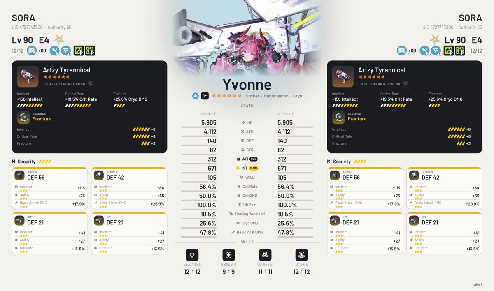
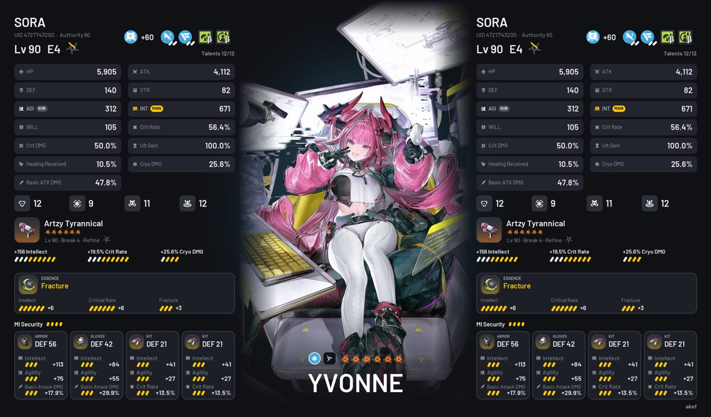

# Compare card

Two players' builds of the same operator side by side.

```py
pages = await cards.render_compare(uid_a, uid_b, "Yvonne")
pages = await cards.render_compare(uid_a, uid_b, ["Gilberta", "chr_0019_karin"], template=2, hidden=True)
```

Level, promotion, potential and talents for each, every stat with bars and the higher value marked, skill
levels, weapon with essence, and gear.

Give it two UIDs (or two profiles from `cards.enka()`) and one operator or a list, by name or id. You get one
card per operator that both players showcase. The rest are skipped with a warning, and if none are on both
you get a `CardError`.

| `template` | |
| --- | --- |
| `1` | light, loadouts down the sides with stats and skills in the middle |
| `2` | dark split: the art down the middle, each player's stats, skills, weapon and gear on their half |

## Templates

=== "Template 1"

    

=== "Template 2"

    
