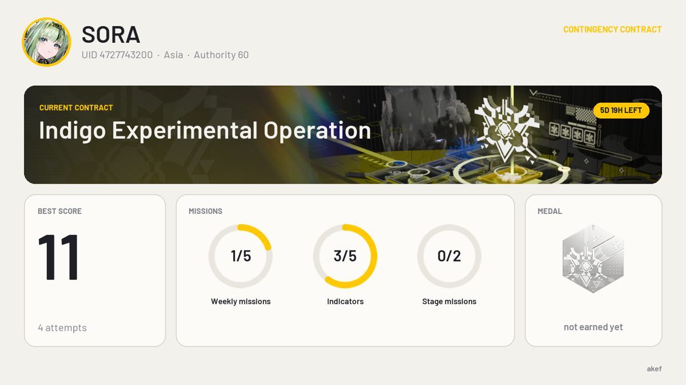
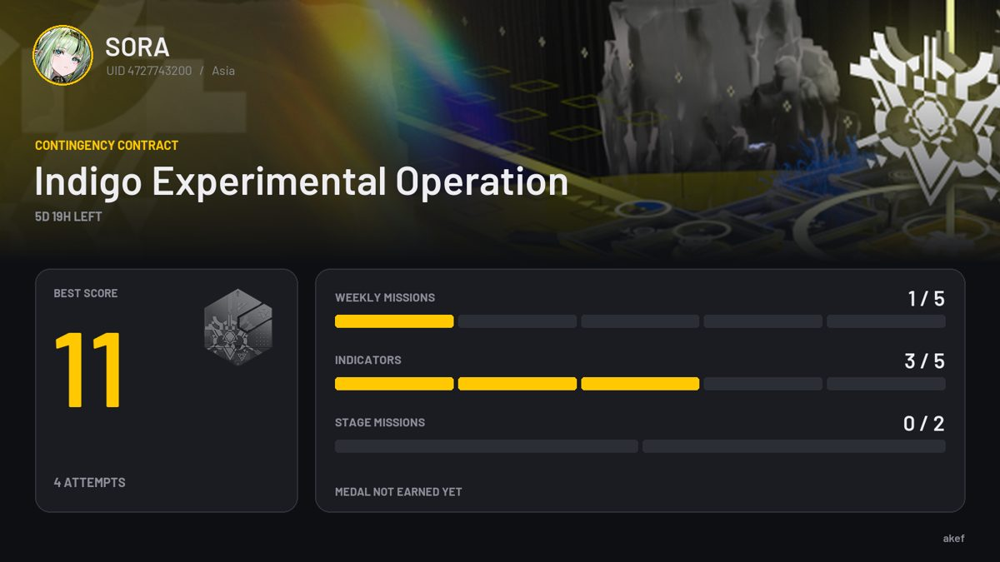
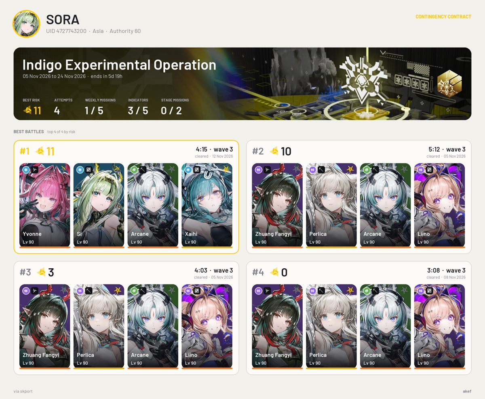
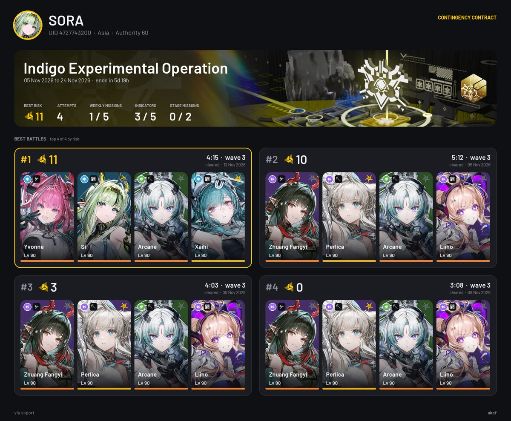

# Contingency Contract cards

SKPORT only. A summary card and a detail card.

## Summary

```py
image = await cards.render_contract(cards.skport_contract(await client.card()), template=1)
```

The running contract with its banner art, best score, attempts, weekly, indicator and stage missions, the
medal (faded until it's earned) and the time left. `template` is `1` light or `2` dark.

=== "Light"

    

=== "Dark"

    

## Detail

```py
detail = cards.skport_contract_detail(await client.card(), await client.contract())
image = await cards.render_contract_detail(detail, template=2)
```

A banner with the best risk, attempts and missions, then your best 4 battles by risk, each with its team as big
portraits, the time, wave and date. Needs `client.contract()` from akef. `template` is `1` light or `2` dark.

=== "Light"

    

=== "Dark"

    
