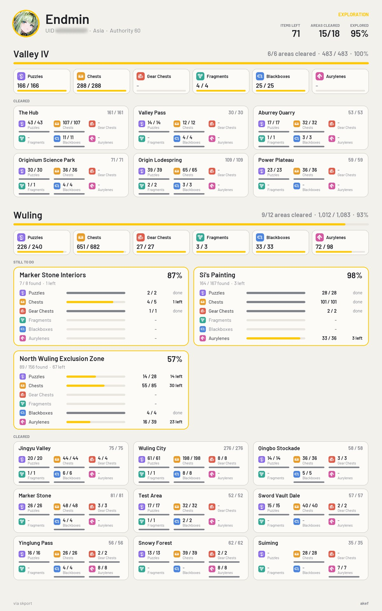
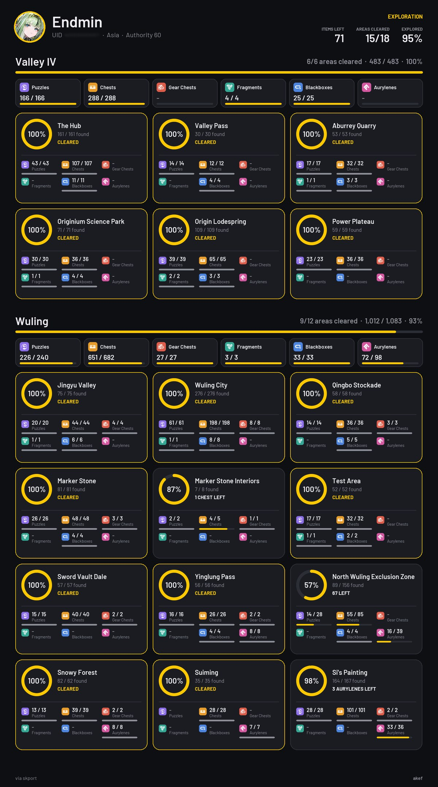
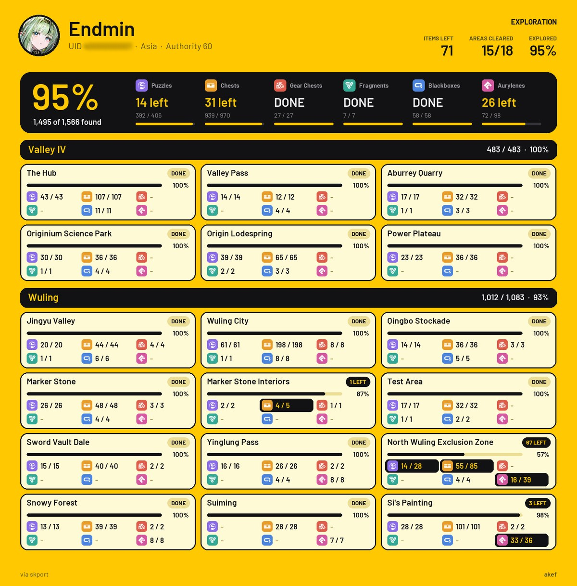

# Exploration card

SKPORT only.

```py
exploration = cards.skport_exploration(await client.card())
image = await cards.render_exploration(exploration, template=1)
```

Every area per region with puzzles, chests, gear chests, fragments, blackboxes and aurylenes.

| `template` | |
| --- | --- |
| `1` | to-do: unfinished areas get big boxes with a row per kind, fewest left first. Cleared ones stay compact |
| `2` | dark, a ring plus all six counts for every area |
| `3` | compact yellow poster, 3 areas a row. The top banner shows what each icon means, kinds with stuff left are blacked out |

All three show the six counts for every area. 1 and 2 also total them per region. `exploration.found`,
`.total` and `.kind_totals()` give you the numbers without drawing.

## Templates

=== "Template 1, to-do"

    

=== "Template 2, rings"

    

=== "Template 3, poster"

    
