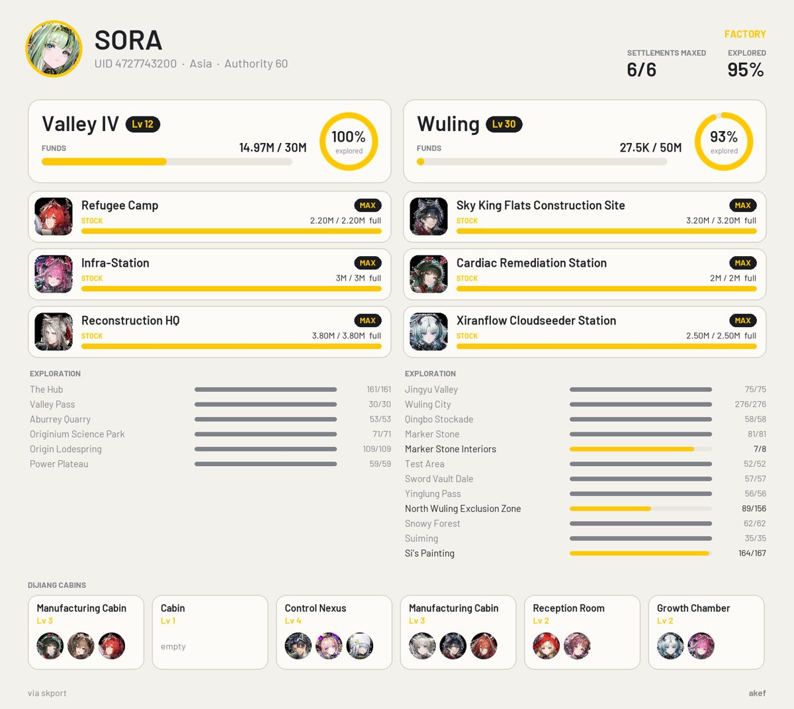
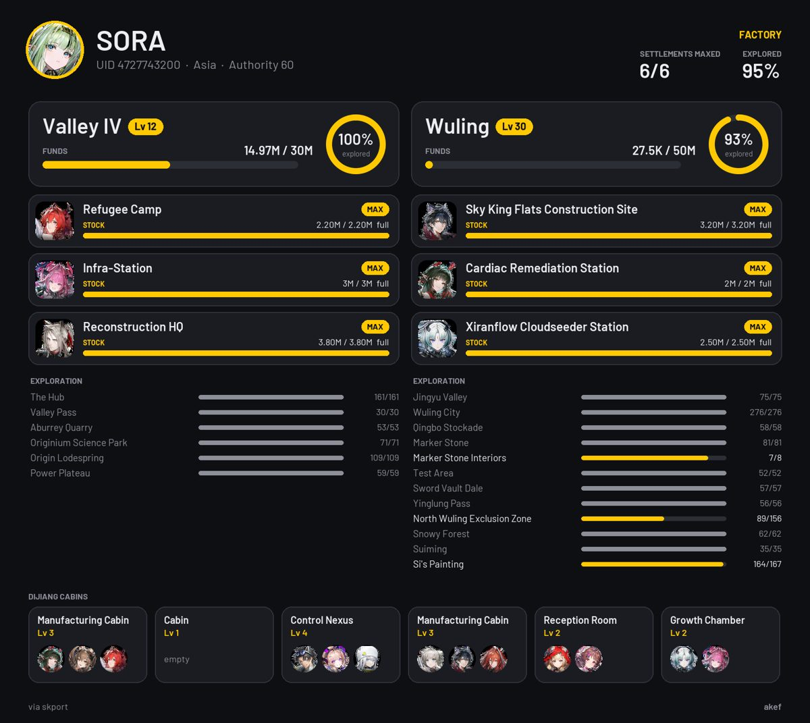

# Factory card

SKPORT only.

```py
factory = cards.skport_factory(await client.card())
image = await cards.render_factory(factory, template=1)
```

Each region with its level, funds and how much is explored, every settlement with its officer, level and
stock, exploration per area, and the Dijiang cabins with their crew. `template` is `1` light or `2` dark.

For exploration on its own, with all six collectible kinds, use the [Exploration](exploration.md) card.

## Template 1



## Template 2


