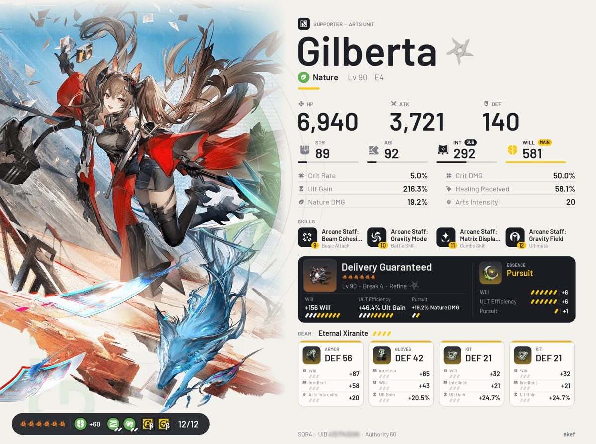

# Cards

Every `render_*` method gives back a Pillow image, or a list when the card has more than one page.
Save it, edit it, or turn it into a file for a bot.

```py
image = await cards.render(build, template=2, hidden=True)
image.save("card.png")
```

## Options every card has

| Option | |
| --- | --- |
| `template=` | picks the look, see each card's page for what's there |
| `hidden=True` | blurs the UID on the card, the wiki cards don't have one |



## Cards as files

`render_bytes()` takes any card's data and gives a `BytesIO` with a file name set, ready for discord.py,
aiogram and friends.

```py
file = await cards.render_bytes(build, format="JPEG", hidden=True)          # card.jpeg
file = await cards.render_bytes(cards.skport_live(card), template=2)         # live.png
files = await cards.render_bytes(player)                                     # profile1.png, profile2.png ...
```

It takes a `Build`, `Live`, `Roster`, `Factory`, `Exploration`, `PullHistory`, `Contracts`, `ContractDetail`,
`Monument`, `Player` or `WikiPage`. The last two give a list, one file a page. `format` is anything Pillow can
save, `"JPEG"` is a lot smaller for bots. `render_compare_bytes()` and `render_monument_event_bytes()` do the
same for those two cards.

## Where the data comes from

| | Enka UID | SKPORT account |
| --- | --- | --- |
| Operators | the in-game showcase, max 4 | every operator on the account |
| Cards | operator, animated, compare, profile | everything except compare |

See [Getting started](../getting-started.md) for both.
