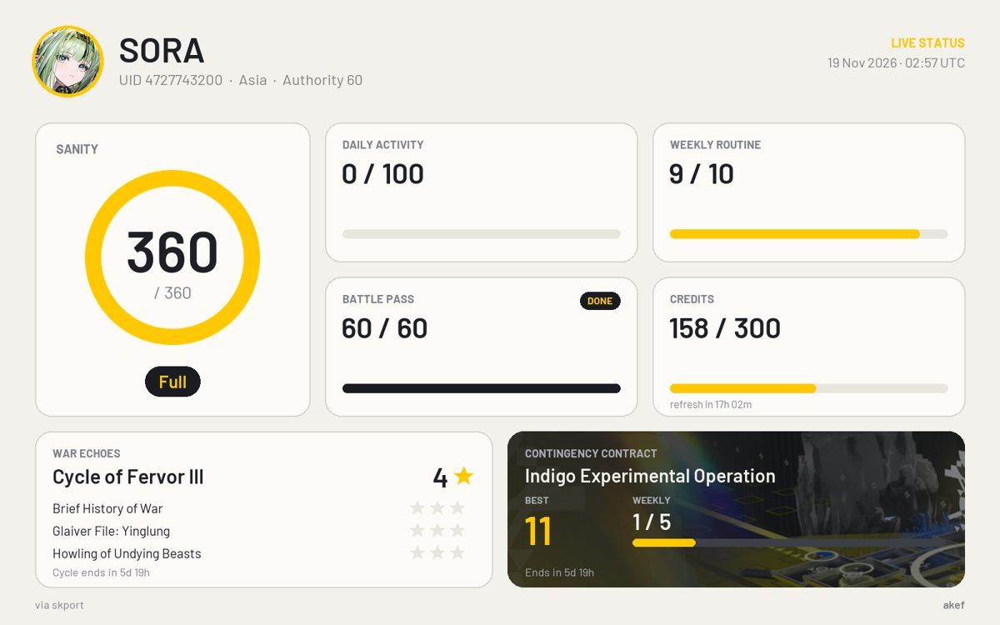
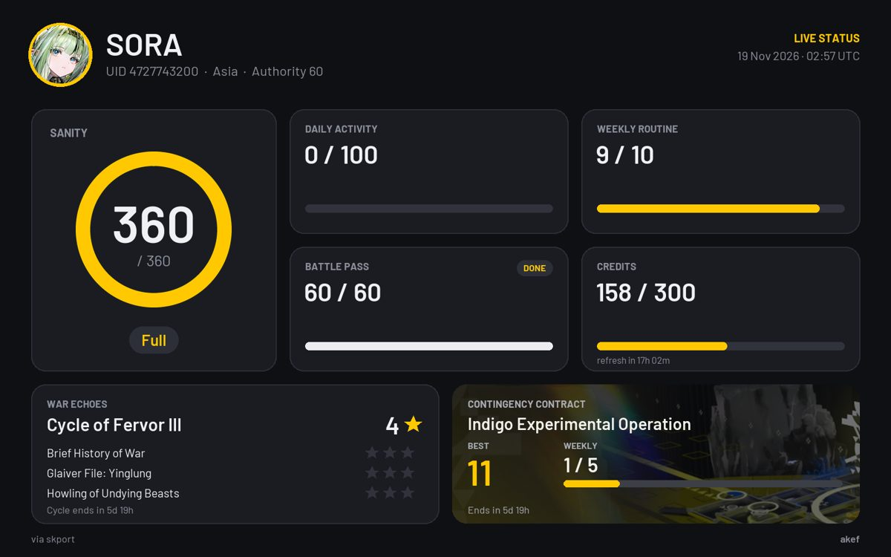

# Live status card

SKPORT only.

```py
live = cards.skport_live(await client.card())
image = await cards.render_live(live, template=2)
```

Sanity with time until full, daily activity, weekly routine, battle pass, credits with the next refresh, the
current War Echoes cycle with stars per stage, and the running Contingency Contract. Times are worked out
from SKPORT's own clock.

`template` is `1` light or `2` dark. The numbers are on `live` too if you want them without a card, see
[Data](../data.md).

## Templates

=== "Template 1"

    

=== "Template 2"

    
