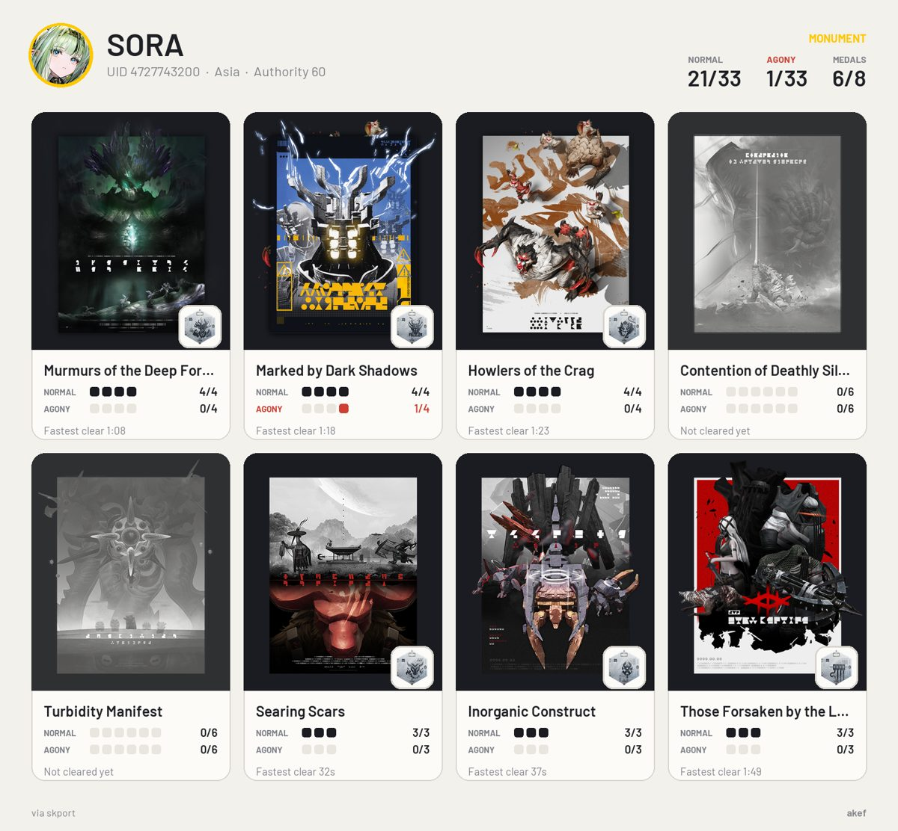
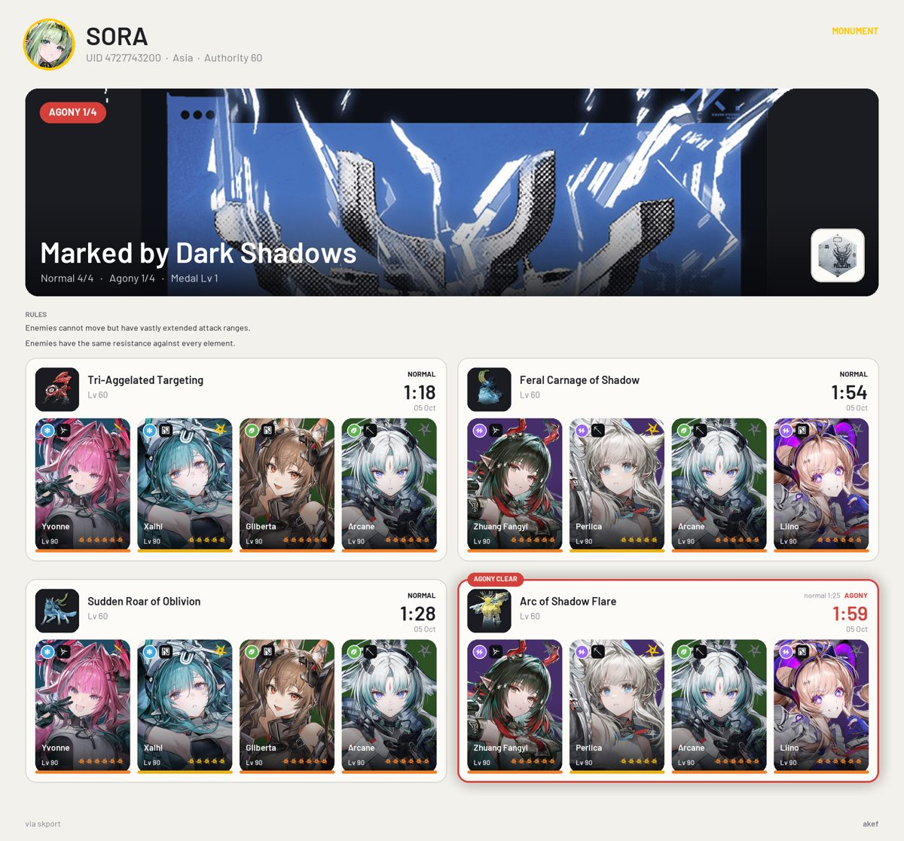
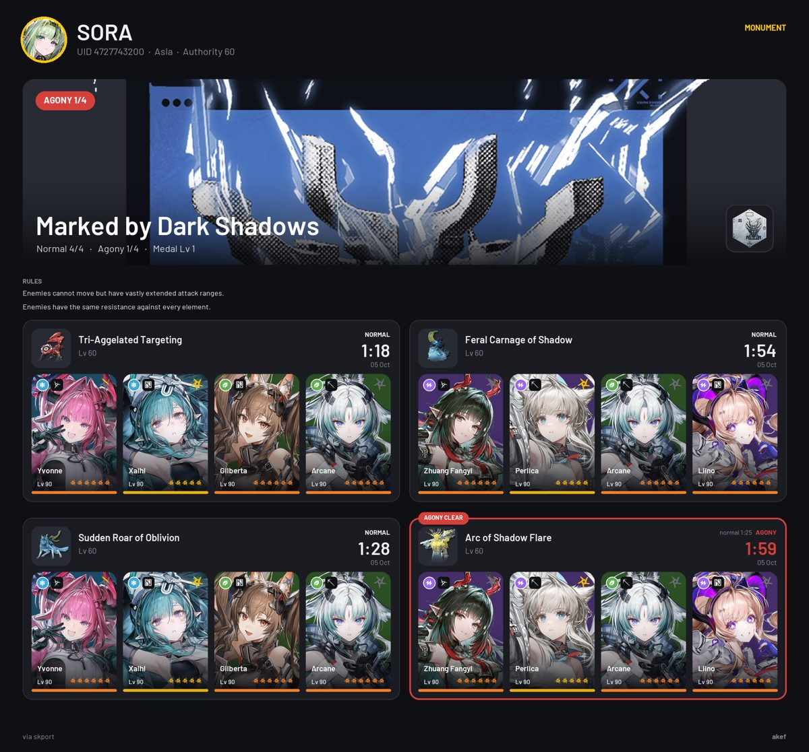

# Monument cards

SKPORT only. Two cards: an overview of every event, and a big card for one event.

```py
monument = cards.skport_monument(await client.card(), await client.monument())
```

## Overview

```py
image = await cards.render_monument(monument)
```

One tile per event with its poster, medal, normal and Agony clears per stage and the fastest clear. Events
never played are greyed out. Stage times and teams are still on `monument.events` for your own use.



## Event

```py
latest = await cards.render_monument_event(monument)                          # running or newest event
one = await cards.render_monument_event(monument, "Marked by Dark Shadows", template=2)
many = await cards.render_monument_event(monument, ["Searing Scars", 0])      # list in, list out
```

One event in full: the poster as a banner, the rules, and each stage with its boss, clear time and the team
that cleared it as big portraits. Agony clears get a red frame and tag. Events can be picked by name, index or
an `Event`. `template` is `1` light or `2` dark.




