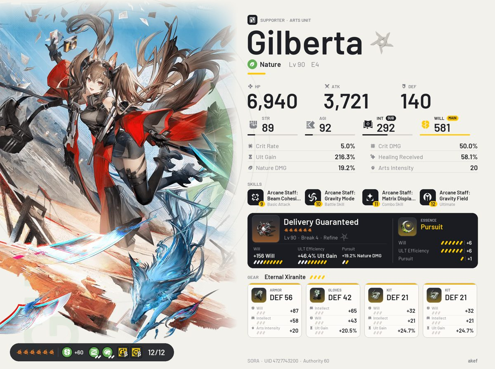
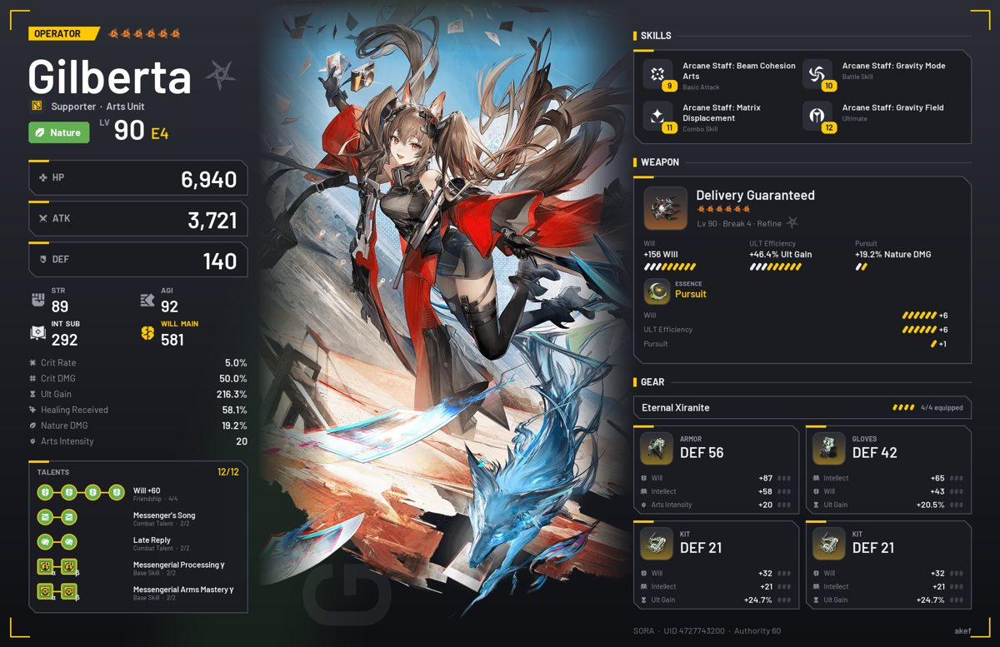

# Operator card

```py
image = await cards.render(build)                # light
image = await cards.render(build, template=2)    # dark, game menu style
```

One operator: splash art, element, level, promotion and potential, final stats, skills with levels,
talents, weapon with its skill values, essence with its points, and gear with every stat line and its level.

Stats are checked against the in-game screen and they match, rounding and all. Enka's site gives Gilberta's
ult gain a talent bonus the game doesn't, so for her we go with the game.

## Options

| Option | |
| --- | --- |
| `template` | `1` light showcase, `2` dark in-game style |
| `art` | your own art instead of the splash, see [Custom art](../custom-art.md) |
| `allow_local` / `allow_remote` | needed for art given as a text path / url |
| `hidden` | blur the UID |

## Getting a build

```py
build = (await cards.enka(uid)).build("Gilberta")      # from the showcase
build = await cards.skport(card, "Arcane")             # any operator on a SKPORT account
```

`skport()` takes a name (any case) or an operator from `card.chars`. Both give the same `Build`, so every
option works the same for either. A build with no stats or gear still draws, those parts just come out empty.

## Templates

=== "Template 1"

    

=== "Template 2"

    
