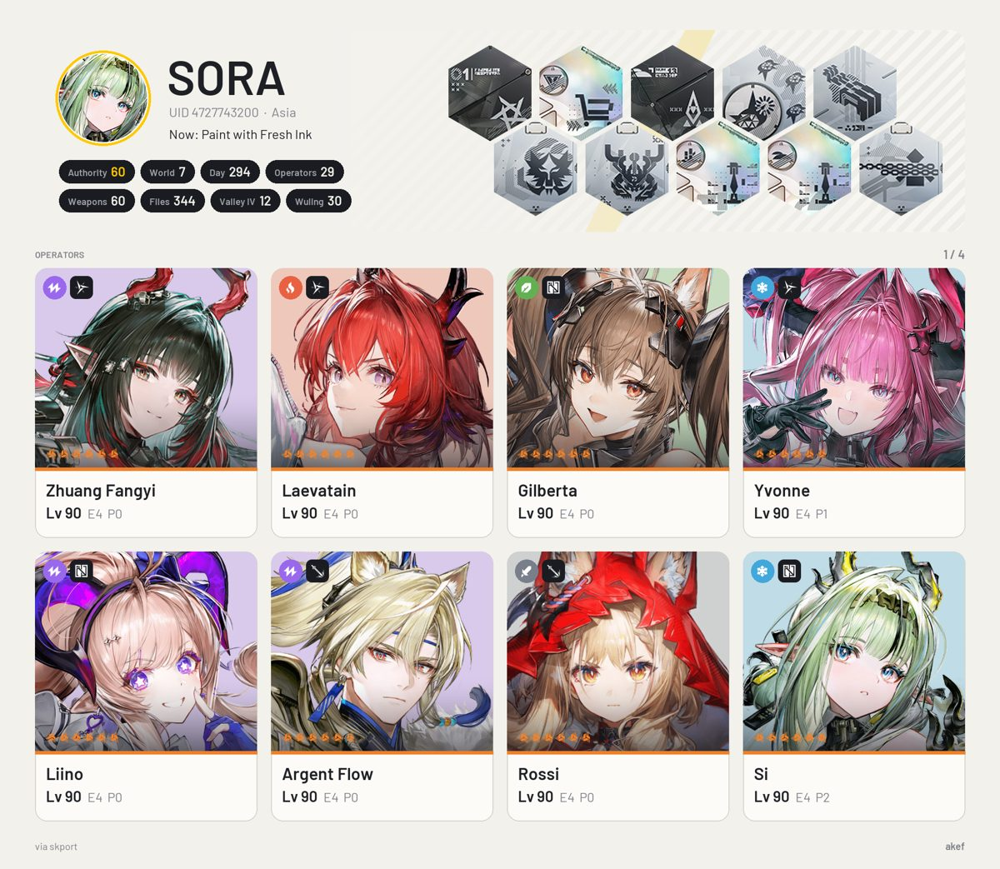
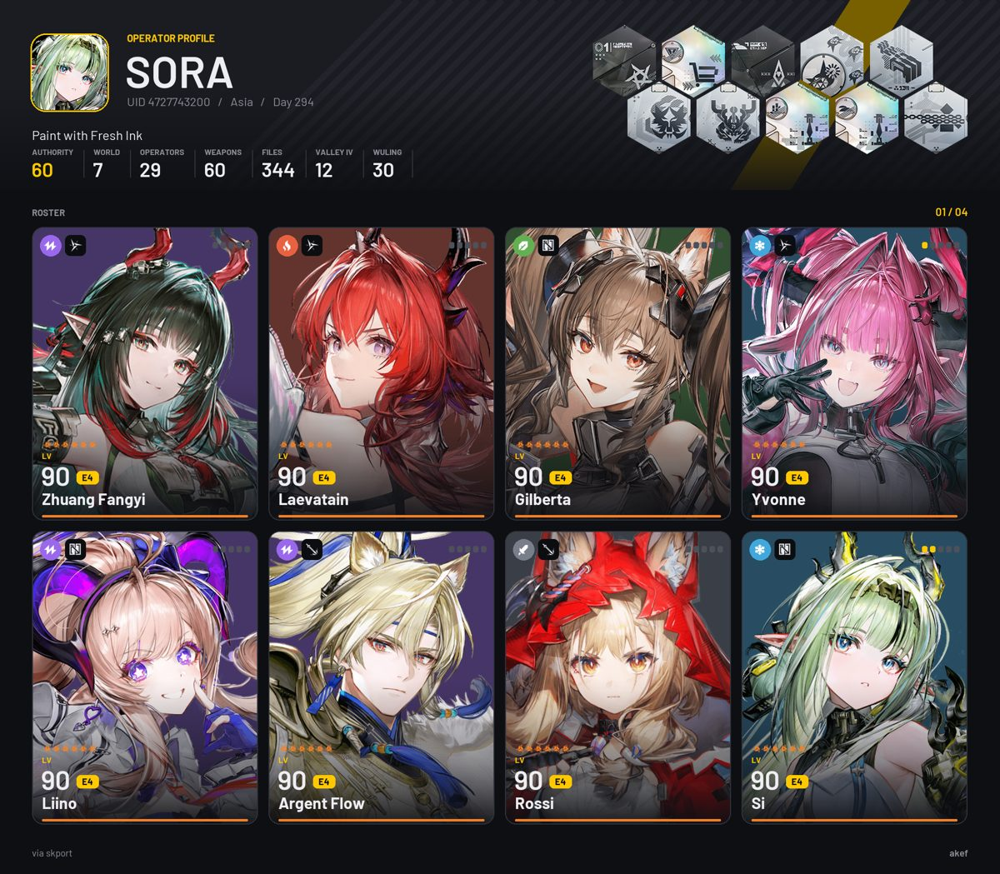
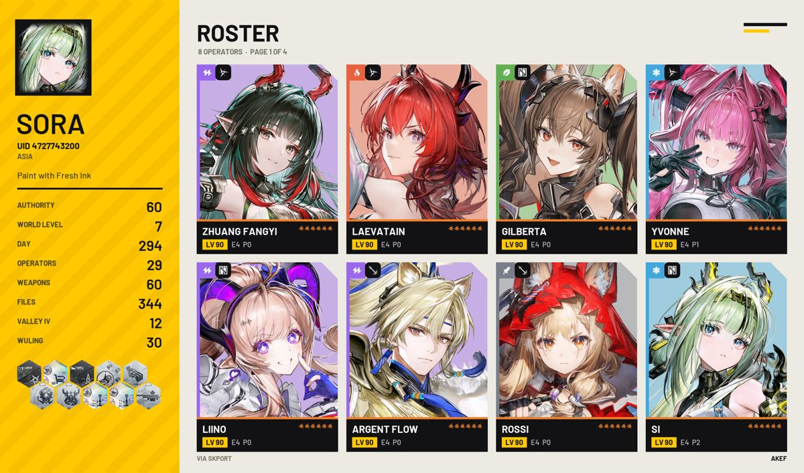

# Profile card

```py
[image] = await cards.render_profile(profile.player)                        # enka, always one page
pages = await cards.render_profile(cards.skport_player(card), grid="3x3")   # skport, whole roster
```

Player name, avatar, signature, Authority and world level, days played, region levels, owned counts,
showcased medals and a grid of operators. Always returns a list of pages.

| Option | |
| --- | --- |
| `template` | `1` light, `2` dark with full-height portraits, `3` yellow poster with the player down the side |
| `grid` | `"4x2"` (8 a page, default) or `"3x3"` (9 a page) |

Enka only has the showcase, so that's one page. SKPORT has the whole roster, so a big account becomes a few
pages. SKPORT profiles put the operators picked for the SKPORT profile first, then the rest by rarity, level
and potential. Enka has no half-body portraits, so each tile is cut from the operator's splash around the face.

## Templates

=== "Template 1"

    

=== "Template 2"

    

=== "Template 3"

    
