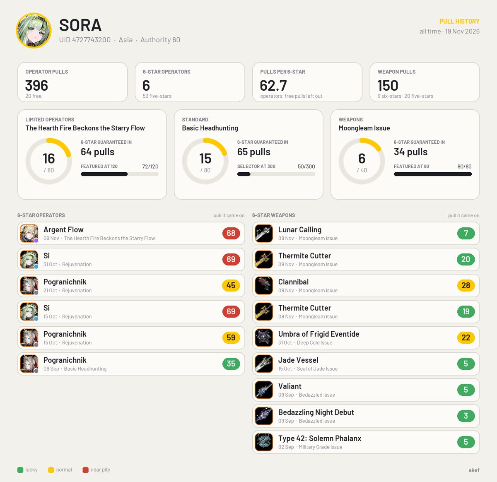
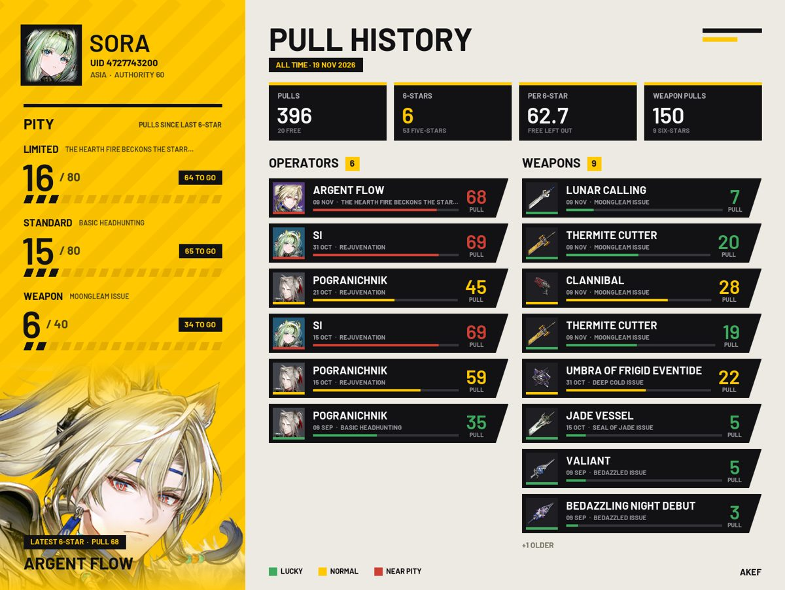

# Pull history card

SKPORT only.

```py
pulls = await client.pulls()
history = await cards.skport_pulls(await client.card(), pulls)
image = await cards.render_pulls(history, template=1)

recent = await cards.skport_pulls(card, pulls, after=date(2026, 11, 1))   # just a period
```

Totals, the pull each 6-star came on (green lucky, yellow normal, red near pity), and current pity for limited,
standard and the latest weapon banner.

With `after=` the card only lists and counts pulls from that date, pity is still worked out from the whole
history you pass in.

| `template` | |
| --- | --- |
| `1` | light board |
| `2` | yellow poster with your latest 6-star down the side |

## Template 1



## Template 2


