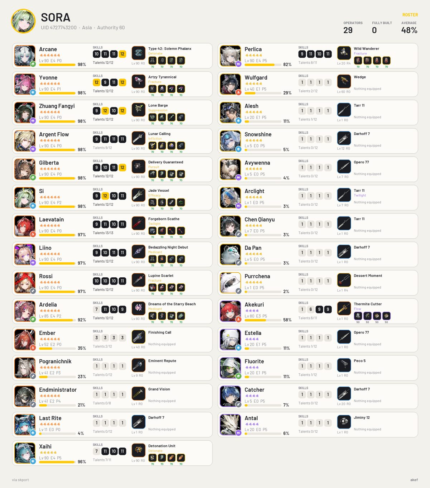

# Roster card

SKPORT only.

```py
image = await cards.render_roster(cards.skport_roster(await client.card()))
```

Everyone you own on one board, each with their level, promotion, skills, weapon and gear, plus a progress score.
The score is equal parts level, promotion, skills, weapon and gear, it doesn't count talents, potential or
essence. One template.


