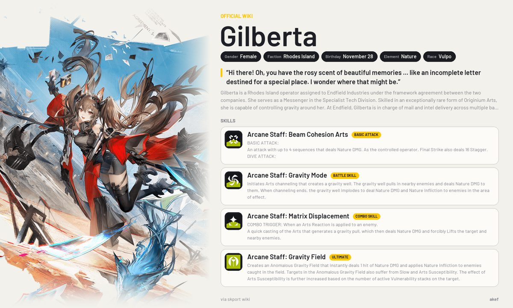
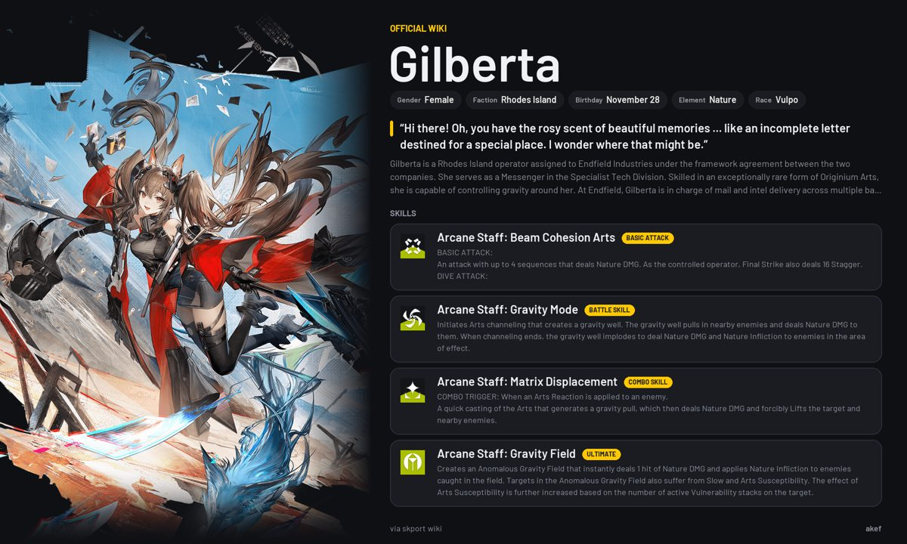
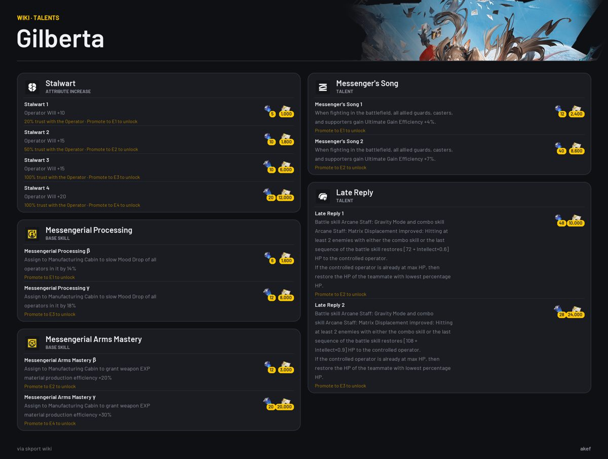

# Wiki cards

An operator's page from SKPORT's official wiki, split in six cards: overview, skills, talents, growth, profile
and lore.

```py
from akef import WikiPart

ops = await client.wiki("operators")
item = await client.wiki_item(next(o for o in ops if o.name == "Arcane").id)
page = cards.wiki(item, await client.wiki_index())

pages = await cards.render_wiki_pages(page)                                    # all six
pages = await cards.render_wiki_pages(page, [WikiPart.SKILLS, WikiPart.LORE])  # just these
image = await cards.render_wiki(page, "talents", template=2)                   # one
```

`wiki_index()` is one more round of requests that names the materials and weapons a page links to. Talents,
growth and profile need it, the other three don't. `template` is `1` light or `2` dark. There's no UID on these,
so no `hidden`.

## Overview





## Talents


