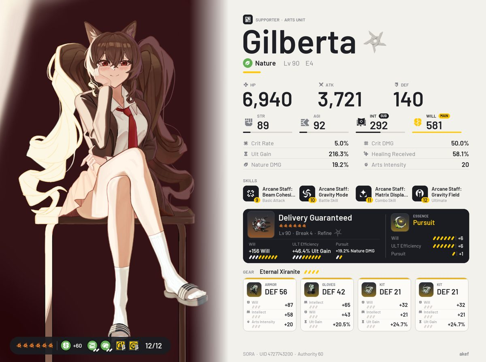
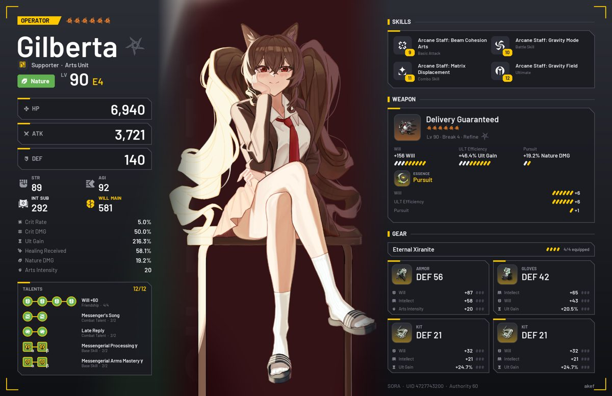
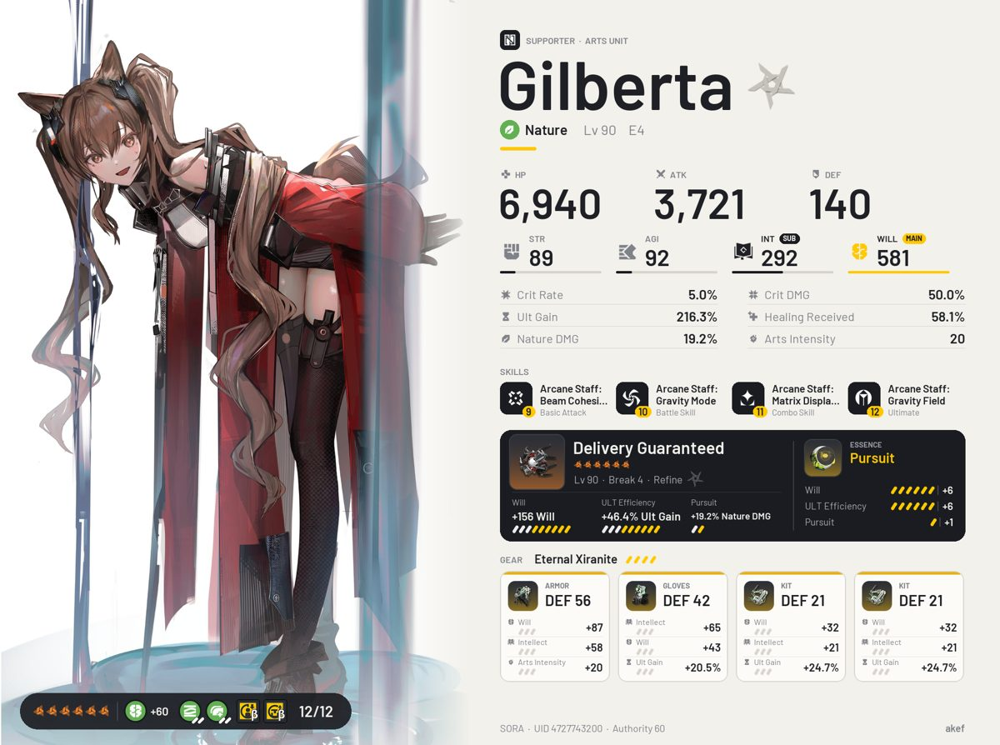
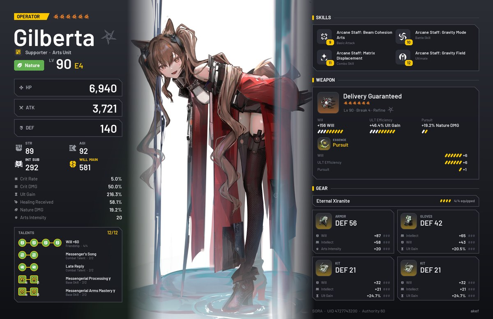

# Custom art

Don't like the default splash? Pass `art=` with your own. Works on both operator templates. On template 1 the
art takes the whole left side.

```py
image = await cards.render(build, art=Path("my_art.png"))
image = await cards.render(build, art=attachment_bytes, template=2)       # from a bot upload
image = await cards.render(build, art=pillow_image)                       # edit it first if you want
image = await cards.render(build, art="my_art.png", allow_local=True)
image = await cards.render(build, art="https://example.com/art.png", allow_remote=True)
```

| You pass | Works |
| --- | --- |
| a Pillow image | always |
| `bytes` | always |
| a `pathlib.Path` | always |
| a path as a string | with `allow_local=True` |
| a url string | with `allow_remote=True` |

## Keeping a bot safe

Text urls and paths are off by default on purpose. If a user can type a path and you pass it straight in,
they could make your bot open files on your machine.

- uploads: pass the bytes, that's always fine
- links from users: `allow_remote=True` is ok. Private and local addresses stay blocked (redirects included),
  downloads stop at 15 MB and after 3 redirects, and proxy env vars aren't used
- never turn on `allow_local` for anything a user typed, or wrap their text in `Path()`

Art over 15 MB or 40 megapixels is rejected with a `CardError`.

## When a url fails

Some image hosts block scripts. Download it yourself (or take it as an upload) and pass the bytes.

Custom art cards are never cached, the art behind a url can change. Icons still come from the cache.

## Examples





art by pigeonfight99





art by kisaragi_pana. The fan art belongs to the artists and isn't covered by the MIT license.

For a moving version see [Animated operator](cards/animated.md).
