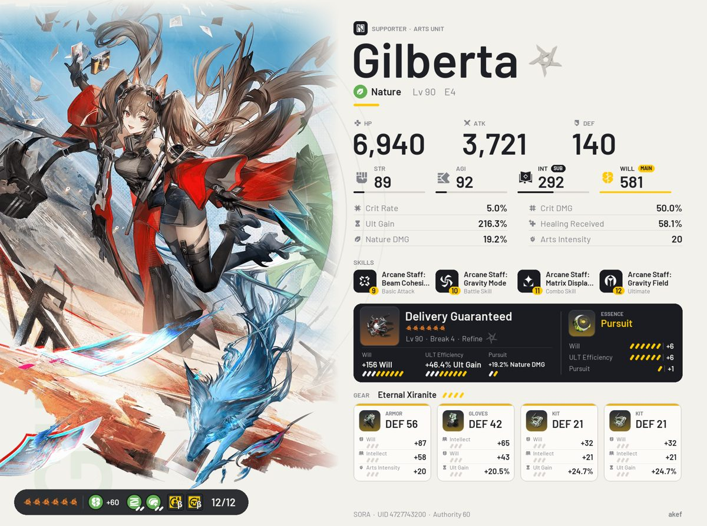
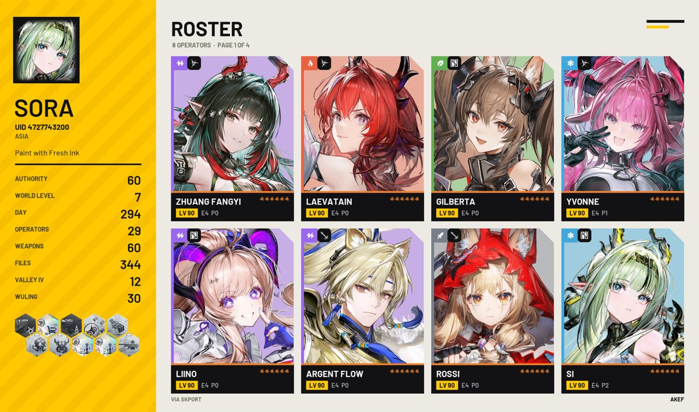
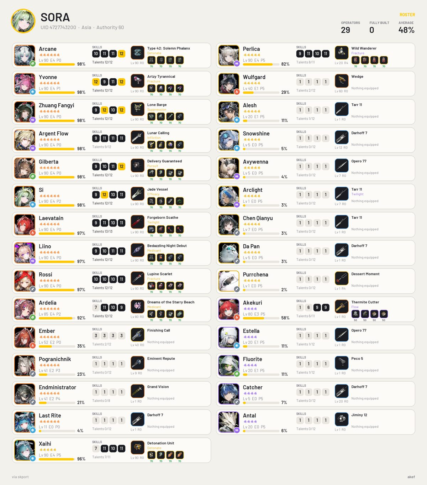
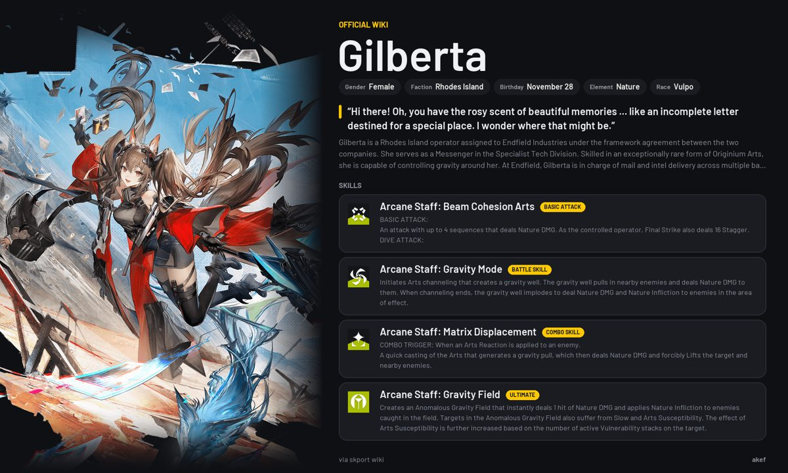

---
hide:
  - navigation
  - toc
---

<div class="hero" markdown>

<div markdown>

# akef<span>-cards</span>

Image cards for Arknights: Endfield. Operator builds, profiles, pulls, exploration and endgame, plus
animated operator cards from your own gif.

[Get started](getting-started.md){ .md-button .md-button--primary }
[Every card](cards/index.md){ .md-button }

</div>

{ .no-zoom }

</div>

```
pip install akef-cards
```

```py
import asyncio
import akef_cards


async def main():
    async with akef_cards.Cards() as cards:
        profile = await cards.enka(4727743200)
        for build in profile.builds:
            image = await cards.render(build)
            image.save(f"{build.name}.png")


asyncio.run(main())
```

Operator, compare and profile cards only need an Enka UID. Everything else reads a SKPORT account through
[akef](https://github.com/ShresthVaibhav/akef), this library just draws.

## The cards

<div class="grid cards" markdown>

-   :material-account-star: **[Operator](cards/operator.md)**

    Final stats, skills, talents, weapon and gear. 2 templates, custom art too.

    { .no-zoom }

-   :material-movie-open: **[Animated operator](cards/animated.md)**

    Your gif as the art. Trim, speed up, bounce, keep it under upload limits.

    { .no-zoom }

-   :material-scale-balance: **[Compare](cards/compare.md)**

    Two players' builds of the same operator side by side.

    { .no-zoom }

-   :material-card-account-details: **[Profile](cards/profile.md)**

    Player info, medals and the roster, 3 templates.

    { .no-zoom }

-   :material-heart-pulse: **[Live status](cards/live.md)**

    Sanity, dailies, weeklies, battle pass and more.

    { .no-zoom }

-   :material-account-group: **[Roster](cards/roster.md)**

    Everyone you own and how trained they are.

    { .no-zoom }

-   :material-factory: **[Factory](cards/factory.md)**

    Regions, settlements and the Dijiang cabins.

    { .no-zoom }

-   :material-map-search: **[Exploration](cards/exploration.md)**

    All six collectible kinds per area, 3 templates.

    { .no-zoom }

-   :material-dice-multiple: **[Pull history](cards/pulls.md)**

    Every 6-star, luck and current pity.

    { .no-zoom }

-   :material-trophy: **[Monument](cards/monument.md)**

    Every event at once, or one event with your teams.

    { .no-zoom }

-   :material-sword-cross: **[Contingency Contract](cards/contract.md)**

    The running contract and your best 4 battles.

    { .no-zoom }

-   :material-book-open-variant: **[Wiki](cards/wiki.md)**

    An operator's official wiki page as six cards.

    { .no-zoom }

</div>

Runnable scripts are in [examples](https://github.com/ShresthVaibhav/akef-cards/tree/main/examples), bot recipes and a
FAQ in the [wiki](https://github.com/ShresthVaibhav/akef-cards/wiki).
