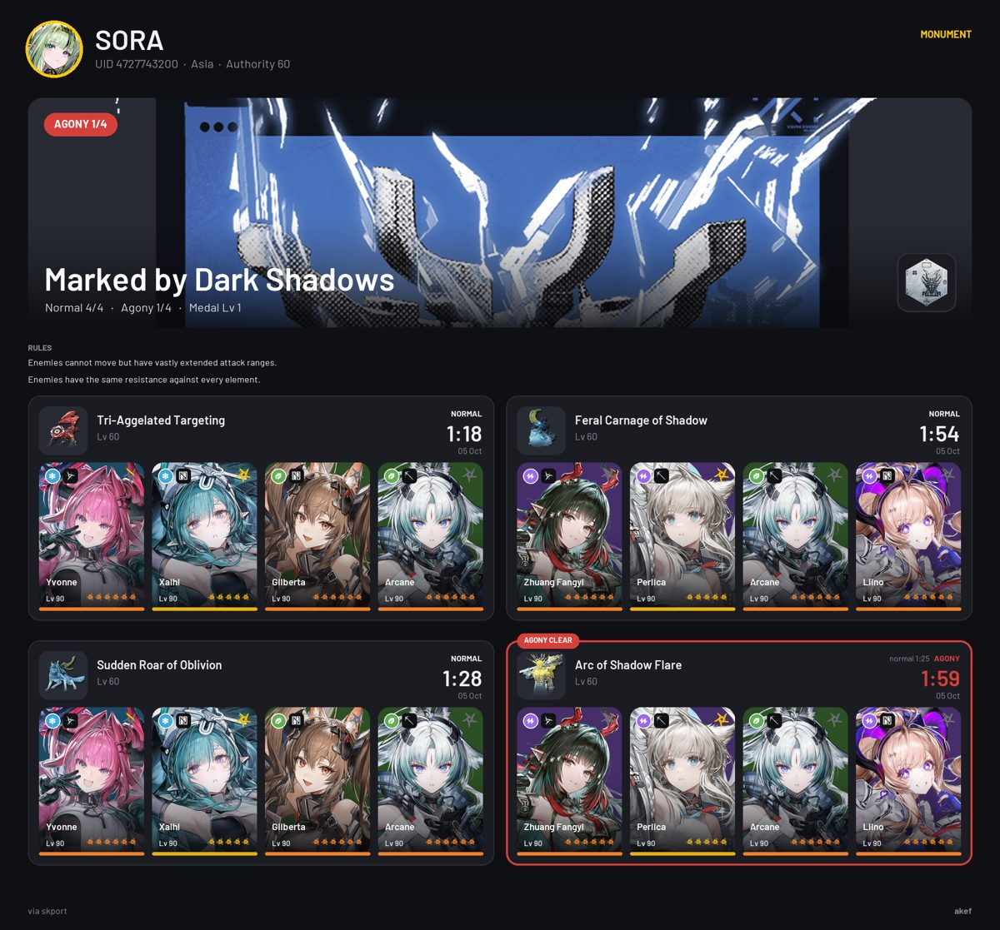

---
hide:
  - navigation
  - toc
---

<div class="band">
<div class="band-inner">
<div class="band-text">
<span class="tag">ARKNIGHTS: ENDFIELD · PYTHON</span>
<h1>akef-cards</h1>
<p>Image cards from your Endfield account. Operator builds with final stats, profiles, pulls, exploration,
endgame, and operator cards that move if you give it a gif.</p>
<p class="band-buttons">
<a class="md-button md-button--primary" href="getting-started/">Get started</a>
<a class="md-button" href="cards/">All cards</a>
</p>
<span class="pip"><code>pip install akef-cards</code><button class="md-clipboard md-icon" data-clipboard-text="pip install akef-cards" title="Copy to clipboard"></button></span>
</div>
<div class="stack">


</div>
</div>
</div>

<div class="home" markdown>

## Every card

<div class="shelf">
<a href="cards/operator/"><b>Operator</b><small>2 templates · custom art</small></a>
<a href="cards/animated/"><b>Animated operator</b><small>gif or webp art</small></a>
<a href="cards/compare/"><b>Compare</b><small>2 templates</small></a>
<a href="cards/profile/"><b>Profile</b><small>3 templates</small></a>
<a href="cards/pulls/"><b>Pull history</b><small>2 templates</small></a>
<a href="cards/exploration/"><b>Exploration</b><small>3 templates</small></a>
<a href="cards/live/"><b>Live status</b><small>2 templates</small></a>
<a href="cards/roster/"><b>Roster</b><small>1 template</small></a>
<a href="cards/factory/"><b>Factory</b><small>2 templates</small></a>
<a href="cards/monument/"><b>Monument</b><small>overview + 2 event templates</small></a>
<a href="cards/contract/"><b>Contingency Contract</b><small>summary + detail</small></a>
<a href="cards/wiki/"><b>Wiki</b><small>6 pages per operator</small></a>
</div>

## Got a gif? It moves

<div class="split" markdown>

<div markdown>

Give the operator card a gif or animated webp and only the art moves, the stats stay put. Trim it, speed it up,
bounce it, and squeeze it under Discord's upload limit before you send it.

```py
card = await cards.animated_card(build, Path("art.gif"), template=2)
small = await card.speed(1.25).fit_under(10)
```

[How it works](cards/animated.md)

</div>

{ .no-zoom }

</div>

## A card in a few lines

<div class="split" markdown>

<div markdown>

```py
async with akef_cards.Cards() as cards:
    profile = await cards.enka(4727743200)
    image = await cards.render(profile.build("Gilberta"), template=2)
    image.save("gilberta.png")
```

</div>

<div markdown>

| | Enka UID | SKPORT account |
| --- | --- | --- |
| Operators | the 4 in your showcase | everyone you own |
| Cards | operator, animated, compare, profile | all of them except compare |

The data side is [akef](https://github.com/ShresthVaibhav/akef), this one only draws.
[Getting started](getting-started.md) has both.

</div>

</div>

<p class="foot-links">
<a href="https://github.com/ShresthVaibhav/akef-cards/tree/main/examples">examples</a> ·
<a href="https://github.com/ShresthVaibhav/akef-cards/wiki">wiki</a> ·
<a href="bots/">using it in a bot</a> ·
<a href="reference/">api reference</a>
</p>

</div>
