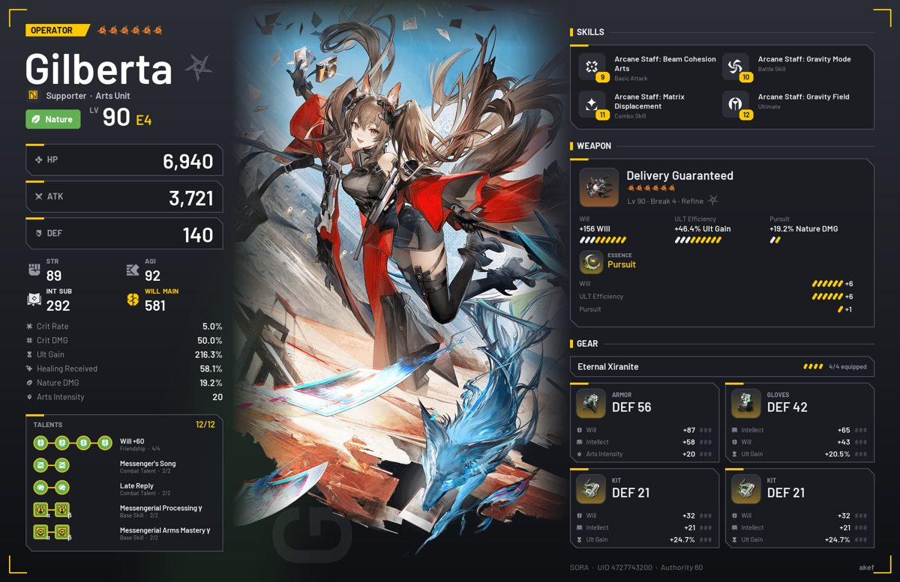
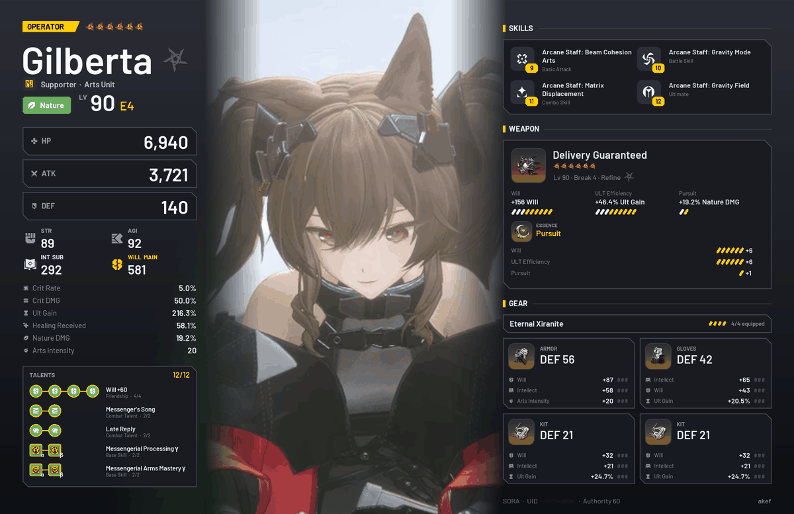
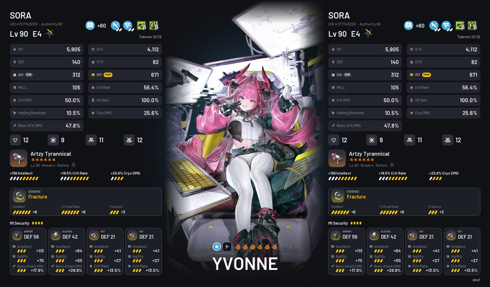
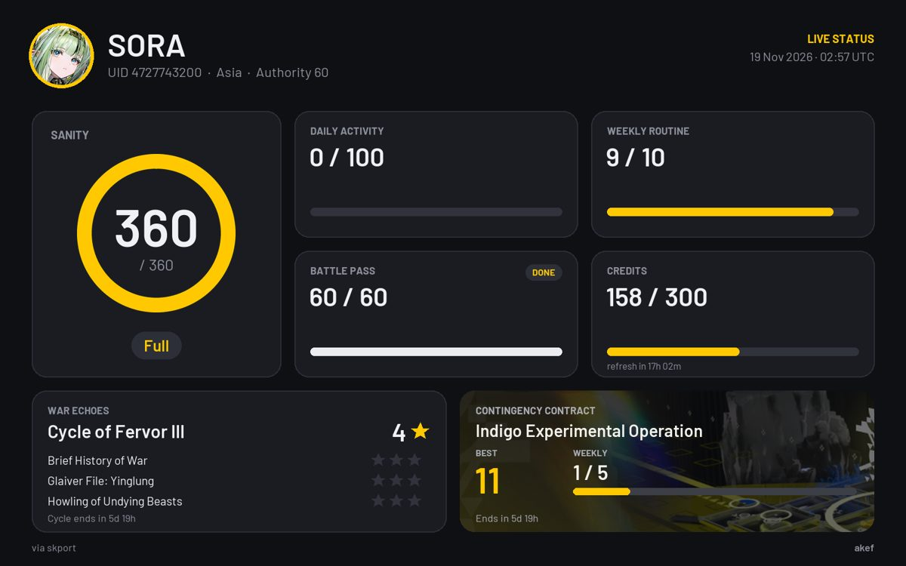
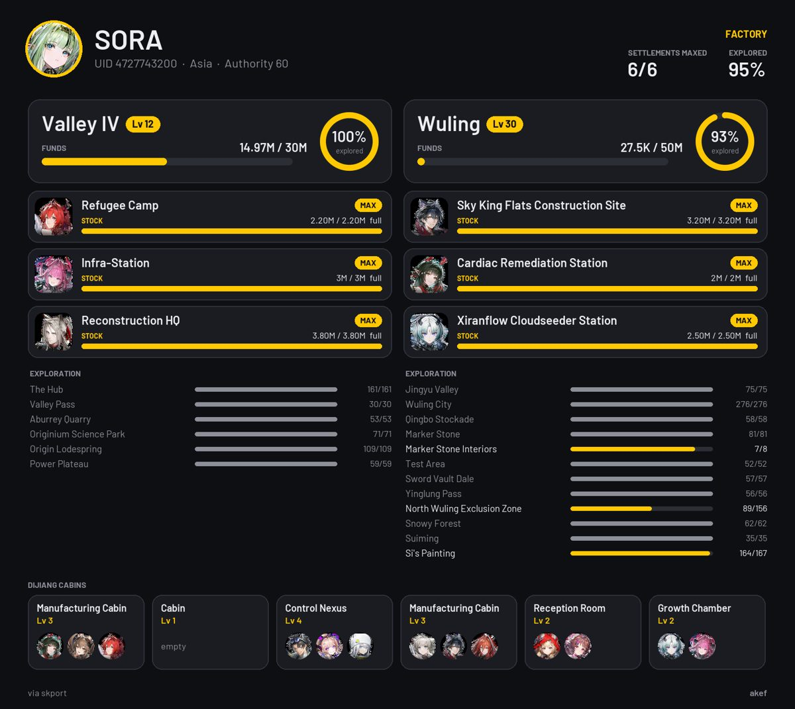
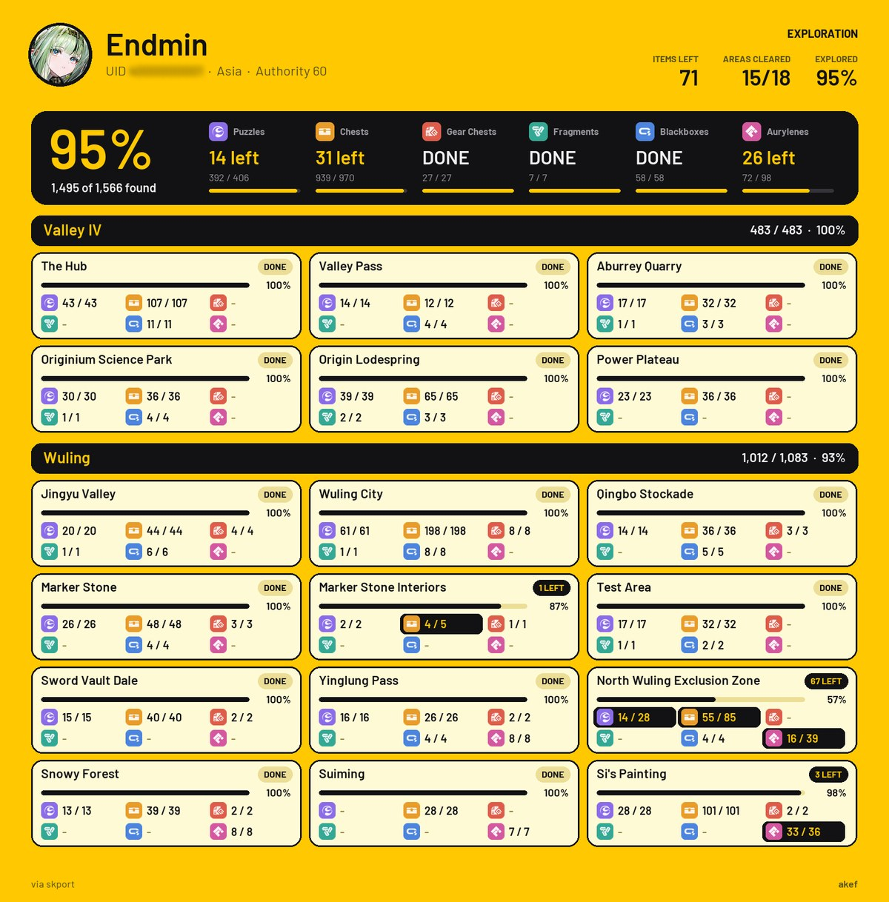
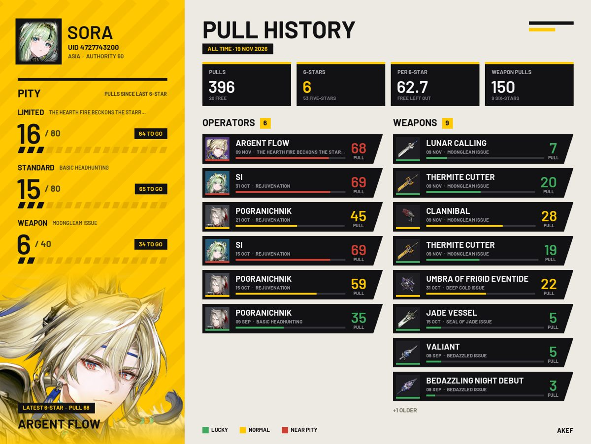
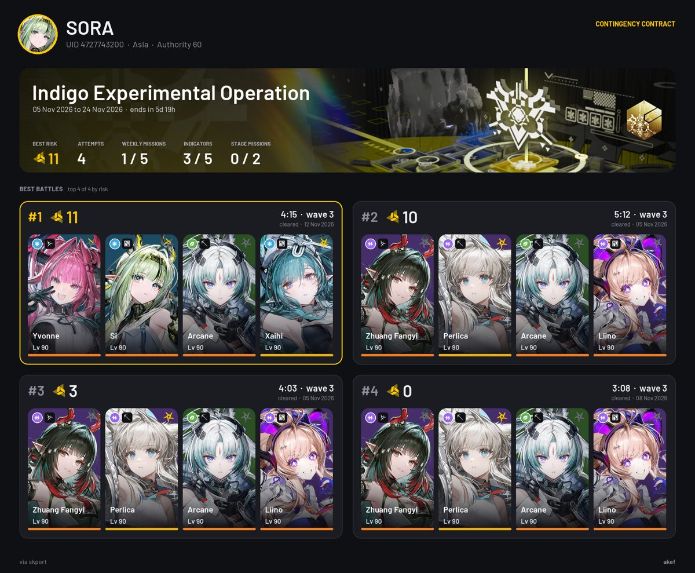

---
hide:
  - toc
---

# akef-cards

Image cards for Arknights: Endfield. Operator builds, profiles, pull history, exploration, endgame stuff, and
animated operator cards if you've got a gif you like.



```
pip install akef-cards
```

```py
import asyncio
import akef_cards


async def main():
    async with akef_cards.Cards() as cards:
        profile = await cards.enka(4727743200)
        for build in profile.builds:
            image = await cards.render(build)
            image.save(f"{build.name}.png")


asyncio.run(main())
```

Operator, compare and profile cards work with just an Enka UID. The rest read a SKPORT account, that part is
[akef](https://github.com/ShresthVaibhav/akef), this one only draws. Start with [Getting started](getting-started.md)
or jump to a card below.

## Cards

<div class="gallery" markdown>

[{ .no-zoom }<br>Operator](cards/operator.md)
[{ .no-zoom }<br>Animated operator](cards/animated.md)
[{ .no-zoom }<br>Compare](cards/compare.md)
[{ .no-zoom }<br>Profile](cards/profile.md)
[{ .no-zoom }<br>Live status](cards/live.md)
[{ .no-zoom }<br>Roster](cards/roster.md)
[{ .no-zoom }<br>Factory](cards/factory.md)
[{ .no-zoom }<br>Exploration](cards/exploration.md)
[{ .no-zoom }<br>Pull history](cards/pulls.md)
[{ .no-zoom }<br>Monument](cards/monument.md)
[{ .no-zoom }<br>Contingency Contract](cards/contract.md)
[{ .no-zoom }<br>Wiki](cards/wiki.md)

</div>

Scripts for all of these are in [examples](https://github.com/ShresthVaibhav/akef-cards/tree/main/examples), bot
recipes and a FAQ are in the [wiki](https://github.com/ShresthVaibhav/akef-cards/wiki).
